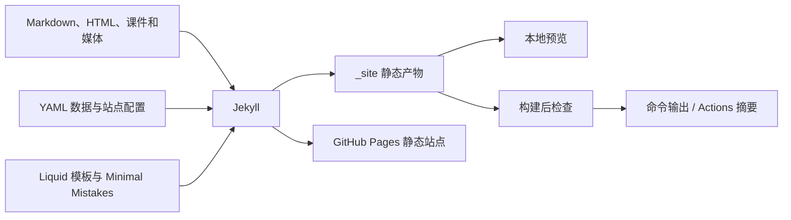

# 站点架构设计

## 当前架构

站点由 Jekyll 生成，使用锁定版本的 Ruby 和 Bundler 依赖，以及固定到提交的 Minimal Mistakes 主题。GitHub Pages 托管静态站点。以下流程对应[需求文档](requirements.md)的 REQ-01 至 REQ-08。

图中的 `_site` 是本地与 CI 构建的输出目录。仓库的 **Check site** workflow 在向 `master` 推送和以它为目标的 PR 上运行 `make check`。

| 模块 | 数据与生成方式 | 对应需求 |
| --- | --- | --- |
| 页面与导航 | 页面前置元数据确定布局和 permalink。主导航来自 `_data/navigation.yml`。站点样式来自主题和 `assets/css/main.scss`。 | REQ-01、REQ-05 |
| 研究与项目列表 | `_data/research.yml` 和 `_data/projects.yml` 分别定义内容，由 `_includes/entry-groups.html` 生成分组、标题、缩略图及链接。构建后按 YAML 核对生成列表。 | REQ-02、REQ-05、REQ-06 |
| 教学目录与课程入口 | `_data/teaching.yml` 定义当前课程、归档课程及有序学期列表。教学目录模板依序呈现学期。每门课程或教程的入口页以目录标识匹配同一条记录，由共享布局用首个学期生成自动跳转及备用链接。课表和课件保存在各课程目录中。 | REQ-03、REQ-04、REQ-05 |
| 图片版课件 | 各课件入口选择 `raster-slides` 布局。布局从 `site.static_files` 生成同一份图片序列，供正文和缩略图使用。 | REQ-03、REQ-08 |
| 构建与检查 | `make check` 先构建，再由 `scripts/check-site.rb` 检查页面结构、研究与项目列表、课程入口、课表、教学目录缩略图 URL 和图片版课件序列，并汇总全站引用告警。Ruby 检查器进程返回非零状态时，Make 提供兜底提示。Jekyll 将维护脚本和文档排除在发布产物之外。 | REQ-06、REQ-07、REQ-08 |

教学与列表术语见 [CONTEXT.md](../CONTEXT.md)。新增学期以登记顺序决定默认学期，历年课表保留原地址。课程目录迁移导致地址变更时，维护者更新教学目录并通知学生使用新地址。构建检查验证现行入口和站内引用。

## 研究与项目列表验证

`scripts/entry-list-check.rb` 接收已解析的 YAML 分组、生成页面和站点 URL，要求每页至少渲染一条条目，并按 YAML 顺序核对分组、条目和链接。无标题组的条目直接位于正文下，条目标题使用 `h2`。有标题组包含 `h2` 组标题和已配置的锚点，组内条目标题使用 `h3`。检查器将解析后的 HTML 标题、缩略图 `src`、链接标签和 `href` 与 YAML 原值比较，涵盖带链接的 venue。

列表内的站内链接和缩略图使用以 `/` 开头的路径。同页锚点（如 `#details`）和外部 URL 也可使用。页面相对路径和使用本站域名的完整 URL 会触发告警。告警定位到分组、条目或字段。`SiteCheck` 分别检查两页，单页数据读取或解析失败时记录检查未完成，并继续其余检查。结果汇入终端和 Actions 摘要。

CI 在全站构建前运行 `bundle exec ruby scripts/entry-list-check-test.rb`。测试用仓库的两页及共享模板构建小型站点，再修改生成的 HTML 验证告警。运行 `make check` 可核对真实列表，随后可在本地预览打开列表中的详情链接。

## 教学目录与课程入口验证

`scripts/teaching-catalog-check.rb` 接收生成目录和已解析的教学数据，核对当前课程与归档课程的顺序、学期链接及标签、课表文件，以及课程入口的 HTML 跳转、JavaScript 跳转和备用链接。检查器返回带来源路径的告警和失败记录。单门课程检查失败后，检查器继续检查其余课程。

### 验收

- 运行 `bundle exec ruby scripts/teaching-catalog-check-test.rb`。测试使用仓库的教学页、课程列表模板和入口布局构建小型站点，验证新增学期后的目录顺序和默认跳转，打开原链接核对旧课表，并验证缺失课表和错误备用链接的报告。CI 在全站构建前运行该测试。
- 运行 `make check`。全站检查使用同一教学检查器，结果汇入终端报告和 Actions 摘要。预览生成的教学目录，打开当前学期与历史学期的课表，并通过课程入口核对默认跳转。

## 图片版课件播放器

课件入口的 `index.html` 保留标题，并声明 `layout: raster-slides` 和 `regenerate: true`。Jekyll 每次增量构建都会重新渲染这些入口。布局只收录与入口同目录且文件名形如 `000.jpg` 的文件，按三位编号升序排列。`000.jpg`、`001.jpg` 和 `003.jpg` 可以连续播放。正文和缩略图由同一序列生成。

共享脚本用同一选中逻辑处理上一张、下一张和缩略图点击。正文和缩略图同时更新，翻页在首尾循环。单张课件翻页后仍显示该张。空目录显示提示，页面省略导航按钮和缩略图。

`bundle exec ruby scripts/raster-slides-test.rb` 用小型 Jekyll 站点检验排序、跳号、文件筛选、正文与缩略图的一致性，以及空目录和单张图片。CI 在构建前运行该测试。`make check` 将真实站点生成的正文和缩略图序列分别与课件目录核对。

## 站内引用检查

对应 REQ-07。`scripts/site-references.rb` 接收生成目录和站点 URL，返回按生成页面定位的诊断及读取失败。它直接覆盖普通页面、历史课表与独立课件。

1. **发现引用。** 遍历生成目录中的 `.html` 和 `.htm`，读取 `a[href]`、`area[href]`、`link[href]`、`[src]`、`video[poster]` 和 `object[data]` 中直接声明的 URL。
2. **解析目标。** 以页面的公开 URL 解析首个有效的 `<base href>`，用有效基址解析引用。只检查与站点同主机的 HTTP(S) 目标及本地构建产物，支持目录首页、无扩展名页面和百分号编码。
3. **验证锚点并汇总。** HTML 目标使用 `id` 和 `a[name]` 校验片段。Reveal 课件的 `#/` 片段由课件运行时解析，检查器验证其目标文件。诊断包含生成页面的相对路径、原始引用和原因，同页重复诊断只报告一次。读取某个页面失败时，报告检查未完成并继续扫描其他页面。

### 验收

- 运行 `bundle exec ruby scripts/site-references-test.rb`，用小型生成目录验证属性覆盖、URL 与锚点规则、Reveal 片段、诊断归属、去重及读取失败。**Check site** workflow 在构建前运行同一组测试。
- 运行 `make check` 验证真实站点的专项检查，以及终端和 CI 摘要中的引用告警。构建成功时告警为提示，构建失败时命令返回失败。

## 后续候选

| 候选 | 机会 |
| --- | --- |
| 站点检查结果报告 | 集中常规运行的结果状态、告警分组和格式化。保留 Make 对检查器进程失败的兜底，让终端和 Actions 摘要共用主要报告规则。 |
