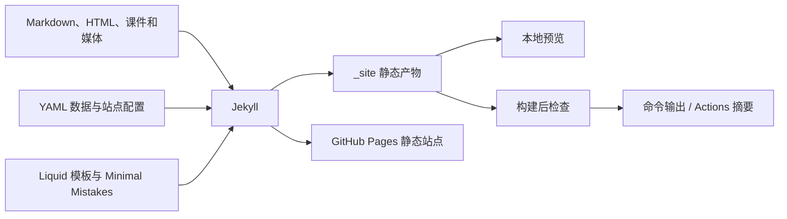

# 站点架构设计

## 当前架构

站点由 Jekyll 生成，使用锁定版本的 Ruby 和 Bundler 依赖，以及固定到提交的 Minimal Mistakes 主题。GitHub Pages 托管静态站点。以下流程对应[需求文档](requirements.md)的 REQ-01 至 REQ-06。

图中的 `_site` 是本地与 CI 构建的输出目录。仓库的 **Check site** workflow 在向 `master` 推送和以它为目标的 PR 上运行 `make check`。

| 模块 | 数据与生成方式 | 对应需求 |
| --- | --- | --- |
| 页面与导航 | 页面前置元数据确定布局和 permalink。主导航来自 `_data/navigation.yml`。站点样式来自主题和 `assets/css/main.scss`。 | REQ-01、REQ-05 |
| 研究与项目列表 | `_data/research.yml` 和 `_data/projects.yml` 分别定义内容，由 `_includes/entry-groups.html` 生成分组、标题、缩略图及链接。 | REQ-02、REQ-05 |
| 教学目录与课程入口 | `_data/teaching.yml` 定义当前课程、归档课程及有序学期列表。教学目录模板依序呈现学期。每门课程或教程的入口页以目录标识匹配同一条记录，由共享布局用首个学期生成自动跳转及备用链接。课表和课件保存在各课程目录中。 | REQ-03、REQ-04、REQ-05 |
| 构建与检查 | `make check` 先构建，再由 `scripts/check-site.rb` 读取站点数据和 `_site`，检查结构、课程入口、已登记的课表链接和列表引用。Ruby 检查器进程返回非零状态时，Make 提供兜底提示。维护文档由 Jekyll 发布排除配置控制。 | REQ-06 |

教学与列表术语见 [CONTEXT.md](../CONTEXT.md)。新增学期以登记顺序决定默认学期，旧入口和课表地址是需兼容的公开接口。

## 站内引用检查深化方案

**状态：规划中。** 对应 REQ-07。当前检查器按页面及选择器挑选引用，同时负责 URL 解析、文件查找、锚点匹配和报告收集。把引用有效性规则放进同一个模块，可以让页面覆盖范围的变化集中在引用发现处，并通过小型生成目录样例验证规则。

1. **集中规则。** 检查模块接收生成目录和配置的站点 URL，返回包含引用页面相对路径、原始引用及原因的诊断，由现有检查流程汇总。以页面 URL 为基准，有 `<base href>` 时用页面 URL 解析该基址。保持当前的同主机 HTTP(S) 判定、目录首页与无扩展名页面查找、百分号解码，以及 HTML 的 `id` 和 `a[name]` 锚点规则。跳过外站和非 HTTP(S) 协议，只读取本地构建产物。
2. **扩展引用发现。** 遍历生成目录内全部 HTML，检查 `a[href]`、`area[href]`、`link[href]`、`[src]`、`video[poster]` 和 `object[data]` 中直接声明的 URL。覆盖历史课表与独立课件。此阶段的范围止于这些 HTML 属性。新版扫描接管已有链接和资源的有效性检查，教学目录顺序、课程跳转和列表缩略图完整性的专项检查继续执行。同一页面的相同引用与原因只报告一次。
3. **沿用发布门槛。** 引用异常按页面归属输出告警，检查未完成仍给出提示。维护者在本地输出和 Actions 摘要查看新增告警，构建失败仍返回失败。历史内容纳入同一套规则。

### 验收

- 用小型生成目录覆盖相对链接、根路径、同主机绝对 URL、自定义基址、目录首页、无扩展名页面、百分号编码和无效 URL。验证缺失或空文件、命名锚点与 `id`、缺失锚点、外站和非 HTTP(S) 跳过，以及同页重复告警合并。
- 验证所有计划内 HTML 属性都能发现引用。分别在课表、独立课件和普通页面样例中放置缺失目标，确认诊断给出各自的页面路径和原始引用。
- 运行 `make check` 验证真实站点的课程顺序、跳转和列表专项检查，并核对站内引用告警能出现在命令输出和 CI 摘要中。验证构建成功时告警保持提示性质，构建失败时命令仍返回失败。

## 后续候选

| 候选 | 机会 |
| --- | --- |
| 教学目录与课程入口验证 | 用同一份小型课程样例验证目录的学期顺序、历史课表和入口的默认跳转，集中教学规则的验收。 |
| 站点检查结果报告 | 集中常规运行的结果状态、告警分组和格式化。保留 Make 对检查器进程失败的兜底，让终端和 Actions 摘要共用主要报告规则。 |
