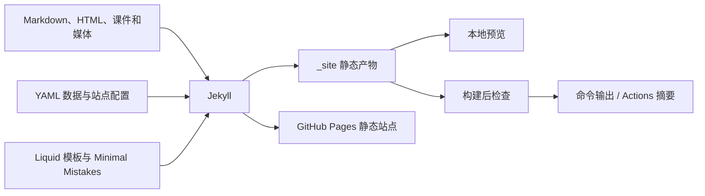

# 站点架构设计

## 当前架构

站点由 Jekyll 生成，使用锁定版本的 Ruby 和 Bundler 依赖，以及固定到提交的 Minimal Mistakes 主题。GitHub Pages 托管静态站点。以下流程对应[需求文档](requirements.md)的 REQ-01 至 REQ-07。

图中的 `_site` 是本地与 CI 构建的输出目录。仓库的 **Check site** workflow 在向 `master` 推送和以它为目标的 PR 上运行 `make check`。

| 模块 | 数据与生成方式 | 对应需求 |
| --- | --- | --- |
| 页面与导航 | 页面前置元数据确定布局和 permalink。主导航来自 `_data/navigation.yml`。站点样式来自主题和 `assets/css/main.scss`。 | REQ-01、REQ-05 |
| 研究与项目列表 | `_data/research.yml` 和 `_data/projects.yml` 分别定义内容，由 `_includes/entry-groups.html` 生成分组、标题、缩略图及链接。 | REQ-02、REQ-05 |
| 教学目录与课程入口 | `_data/teaching.yml` 定义当前课程、归档课程及有序学期列表。教学目录模板依序呈现学期。每门课程或教程的入口页以目录标识匹配同一条记录，由共享布局用首个学期生成自动跳转及备用链接。课表和课件保存在各课程目录中。 | REQ-03、REQ-04、REQ-05 |
| 构建与检查 | `make check` 先构建，再由 `scripts/check-site.rb` 检查页面结构、课程入口、课表和列表缩略图 URL，并汇总全站引用告警。Ruby 检查器进程返回非零状态时，Make 提供兜底提示。Jekyll 将维护脚本和文档排除在发布产物之外。 | REQ-06、REQ-07 |

教学与列表术语见 [CONTEXT.md](../CONTEXT.md)。新增学期以登记顺序决定默认学期，旧入口和课表地址是需兼容的公开接口。

## 站内引用检查

对应 REQ-07。`scripts/site-references.rb` 接收生成目录和站点 URL，返回按生成页面定位的诊断及读取失败。它直接覆盖普通页面、历史课表与独立课件。

1. **发现引用。** 遍历生成目录中的 `.html` 和 `.htm`，读取 `a[href]`、`area[href]`、`link[href]`、`[src]`、`video[poster]` 和 `object[data]` 中直接声明的 URL。
2. **解析目标。** 以页面的公开 URL 解析首个有效的 `<base href>`，用有效基址解析引用。只检查与站点同主机的 HTTP(S) 目标及本地构建产物，支持目录首页、无扩展名页面和百分号编码。
3. **验证锚点并汇总。** HTML 目标使用 `id` 和 `a[name]` 校验片段。Reveal 课件的 `#/` 片段由课件运行时解析，检查器验证其目标文件。诊断包含生成页面的相对路径、原始引用和原因，同页重复诊断只报告一次。读取某个页面失败时，报告检查未完成并继续扫描其他页面。

### 验收

- 运行 `bundle exec ruby scripts/site-references-test.rb`，用小型生成目录验证属性覆盖、URL 与锚点规则、Reveal 片段、诊断归属、去重及读取失败。**Check site** workflow 在构建前运行同一组测试。
- 运行 `make check` 验证真实站点的专项检查，以及终端和 CI 摘要中的引用告警。构建成功时告警为提示，构建失败时命令返回失败。

## 后续候选

| 候选 | 机会 |
| --- | --- |
| 旧课程 URL 兼容 | 从已发布的旧课程入口和课表地址验收课程目录迁移。 |
| 教学目录与课程入口验证 | 用同一份小型课程样例验证目录的学期顺序、历史课表和入口的默认跳转，集中教学规则的验收。 |
| 站点检查结果报告 | 集中常规运行的结果状态、告警分组和格式化。保留 Make 对检查器进程失败的兜底，让终端和 Actions 摘要共用主要报告规则。 |
