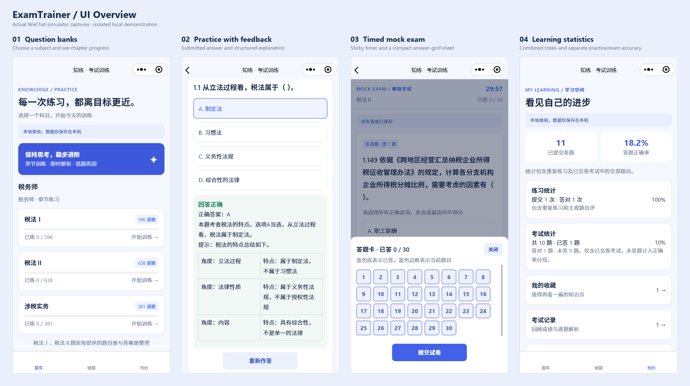

Progress: writing ...
{: .notice--danger}
<!-- Progress: proofreading ...
{: .notice--warning} -->

# 知练 (ExamTrainer): A Personal Exam-Preparation App

*知练 in the WeChat simulator: choose a subject, read formatted practice feedback, use the exam answer-grid sheet, and review combined and separate learning statistics. Local demonstration activity is shown.*

知练 is a WeChat mini program for personal exam preparation. It brings question practice, feedback, and review into one small app, making it easier to return to a subject and continue studying. Its blue-and-white interface keeps the focus on the questions and the next useful step.

The project is also a practice in **vibe coding**: using AI-assisted development to build something useful for a personal need. The aim is a practical study companion, with a clear cycle of trying a question, checking the answer, and revisiting what needs more attention.

The current question banks cover three tax-agent exam subjects: Tax Law I (税法Ⅰ), Tax Law II (税法Ⅱ), and Tax-Related Services Practice (涉税实务). Together, they contain 1,615 questions organized by chapter. Chapter practice shows answers and explanations after submission and supports returning to an earlier position. For written-response questions, learners can compare their own answer with a reference answer and assess whether they have mastered it.

Timed mock exams provide another way to prepare, drawing objective questions into a shorter exam session. Learners can move between questions, use an answer grid, and review their score and individual explanations after submitting. The countdown continues when the app goes into the background.

Wrong answers are collected for focused review, while favorites keep useful questions close at hand. Learning statistics show combined totals alongside separate practice and exam accuracy, including unanswered exam questions. Chapter progress records how many different questions have been attempted. Exam history makes earlier results available for another look.

The app supports both local use and a cloud mode tied to WeChat identity. Local records stay on the device; they can be lost if its storage is cleared. For personal preparation, 知练 offers a straightforward routine: practice, read the explanation, and come back to the difficult questions.
